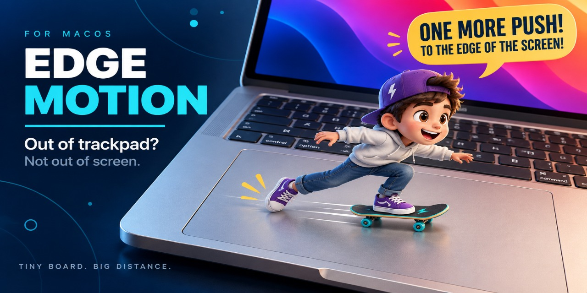

# EdgeMotion

**Out of trackpad? Not out of screen.** Keep your Mac cursor moving beyond the edge.

## Hardware feasibility diagnostic

`EdgeMotionHardwareDiagnostic` is a deliberately separate, non-sandboxed command-line harness. It is not the production menu-bar utility and does **not** establish system-wide support until each machine has been exercised on real hardware.

## Run a controlled check

Build and run it from an interactive macOS login session on a real MacBook:

```
swift run EdgeMotionHardwareDiagnostic --seconds=12 --sample
```

Keep another app in the foreground, then touch, move, and lift one finger on the built-in trackpad; repeat with two fingers. `--sample` prints one decoded frame only. The final summary records callback and frame counts, stability of both `pathIndex` and `fingerID`, disappeared identifiers, finger-up frames, and invalid frames. It never writes touch data to disk.

Accessibility is not a prerequisite for reading raw frames. If it is granted, the harness posts exactly one one-pixel public `CGEvent` mouse move after a validated frame as the output proof. If it is unavailable, the raw-touch result remains useful but the Quartz-output part is explicitly unverified.

Record one short evidence entry per machine: `sw_vers`, `uname -m`, `sysctl -n hw.model`, device identity (built-in versus external), private framework/symbol availability, the final summary, foreground-app Quartz output result, and the safe-disable result. Do not retain raw touch history, keyboard data, or event streams.

If a framework/symbol/device/callback/frame check fails, `SAFE DISABLED` is the expected result: there must be no synthetic output. The bridge assumes a reverse-engineered 96-byte `MTTouch` layout and returns `int32_t(0)` from the private callback; a successful run is hardware evidence, not a public Apple API contract. This harness does not require root, SIP changes, a kext, or a driver.
